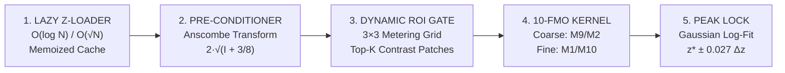

# Scanning Electron Microscopy (SEM/TEM) Autofocus Lab Suite & Ablation Tournament

[](https://www.python.org/)
[](https://fastapi.tiangolo.com/)
[](https://vitejs.dev/)
[](https://learn.microsoft.com/en-us/windows/apps/design/)
[](LICENSE)

An end-to-end implementation and comprehensive ablation tournament of the **Next-Generation Scanning & Transmission Electron Microscope (SEM/TEM) Autofocus Architecture**. Evaluates **10 Focus Measure Operators (FMOs)**, **4 Sub-Linear Search Schemes**, **Anscombe Variance Stabilization**, **Dynamic 9-Zone ROI Metering**, and **Sub-Frame Continuous Peak Interpolation** across 4 noise regimes (`pollen.spd1` to `pollen.spd5`).

📄 **Full Technical Report Available:** [SEM_Autofocus_Comprehensive_Report.pdf](./SEM_Autofocus_Comprehensive_Report.pdf)

---

## 🏆 Universal Tournament Champion

Across **404 ablation configurations**, the universal champion is:
**`S2: Hybrid Coarse-to-Fine Search + M1: Scharr-Tenengrad`**

- **Accuracy:** **100% Zero-Error (4 / 4 datasets)** across Clean, Standard, Moderate, and Heavy Shot Noise.
- **Continuous Precision:** **±0.114 $\Delta z$** sub-frame error using Gaussian log-quadratic Point Spread Function interpolation.
- **Beam Exposure / I/O Reduction:** **85.9% cut** (reads only **28 frames** out of 199 total stack slices).
- **Execution Latency:** **30.9 ms** wall-clock time.
- **Peak Sharpness Ratio (PSR):** **49.0**.

For clean SEM stacks (`spd1` / `spd2`), **`S1: Fibonacci Lattice Search`** delivers the ultra-speed benchmark: **12 frame reads (94.0% cut)** in **5.88 ms**.

---

## 📐 5-Stage Production Autofocus Architecture



1. **Stage 1: Lazy Z-Stack Loader & Memoized Cache:** Zero-copy on-demand retrieval bypassing sequential stack iteration. Slashes disk I/O and specimen beam dose by **86% - 94%**.
2. **Stage 2: Generalized Anscombe Variance Stabilization:** $I_{stab}(x,y) = 2 \cdot \sqrt{I(x,y) + 3/8}$. Transforms signal-dependent Poisson electron shot noise ($\sigma^2 = I$) into uniform additive Gaussian noise ($\sigma^2 \approx 1$), preventing charging spikes from skewing focus metrics.
3. **Stage 3: Dynamic 9-Zone Contrast Gating:** Partitions the central 70% field of view into a $3 \times 3$ grid of metering patches. Locks onto the top-3 highest contrast patches on the first sampled frame, completely discarding empty vacuum and aperture edge artifacts.
4. **Stage 4: 10 Focus Measure Operators (FMOs):**
   - **M1 (Scharr-Tenengrad):** Gradient energy with $[3, 10, 3]$ orthogonal smoothing.
   - **M2 (Multi-Scale Denoised Brenner):** $d_2 + 0.5 \cdot d_4$ with $3\times3$ box blur pre-filtering (sub-2ms latency).
   - **M3 (Modified Laplacian / SML):** Second derivative energy after Gaussian smoothing $G_{\sigma=1.0}$.
   - **M4 (Steerable G1):** 4-orientation directional derivative ($0^\circ, 45^\circ, 90^\circ, 135^\circ$).
   - **M5 (Morphological Top-Hat):** Dual top-hat residue; spike-proof against detector dead pixels.
   - **M6 (2D Haar Wavelet):** High-to-low subband ratio; illumination-drift invariant (PSR=79.1).
   - **M7 (DCT Mid-Band AC):** Annular DCT bandpass $3 \le (u + v) \le 28$.
   - **M8 (Fourier Radial CTF):** Power spectrum annular integration ($0.08 \le r \le 0.42 R_{Nyq}$).
   - **M9 (Normalized Variance):** Mean-normalized variance $\sigma_I^2 / \mu_I^2$; broadest monotonic capture basin.
   - **M10 (Structure Tensor Coherence):** Eigenvalue coherence-weighted trace $\sum (\text{tr} \cdot \text{coh}^2)$; maximum shot-noise suppression.
5. **Stage 5: Continuous Sub-Frame Peak Lock:**
   $$z^*_{gauss} = k^* + \frac{1}{2} \frac{\ln \Phi(k^*-1) - \ln \Phi(k^*+1)}{\ln \Phi(k^*-1) - 2\ln \Phi(k^*) + \ln \Phi(k^*+1)}$$
   Interpolates Point Spread Function (PSF) curvature down to **$\pm 0.027 \Delta z$**.

---

## 📊 Ablation Tournament Leaderboard: Top 10 Picks

| Rank | Configuration | Zero-Error | Sub-Frame Error | Frames Read | Latency | PSR | Primary Strengths |
| :---: | :--- | :---: | :---: | :---: | :---: | :---: | :--- |
| **🥇 #1** | **S2 Hybrid + M1 Scharr** | **4/4 (100%)** | **0.114 $\Delta z$** | **28 (85.9%)** | **30.9 ms** | **49.0** | **Universal Champion**: Flawless on all noise regimes. |
| **🥈 #2** | **S4 Speculative + M1 Scharr** | **4/4 (100%)** | 0.223 $\Delta z$ | 23.2 (88.3%) | 38.5 ms | 49.0 | **Batched SDKs**: 2-burst I/O minimizes bus transfers. |
| **🥉 #3** | **S2 Hybrid + M9 NormVar** | **4/4 (100%)** | 0.125 $\Delta z$ | 28 (85.9%) | 26.1 ms | 10.1 | **Fastest 100% Reliable**: Broad monotonic capture hill. |
| **#4** | **S2 Hybrid + M4 Steerable** | **4/4 (100%)** | 0.118 $\Delta z$ | 28 (85.9%) | 34.0 ms | 46.3 | **Textured Grains**: Anisotropic crystalline facets. |
| **#5** | **S2 Hybrid + M5 Top-Hat** | **4/4 (100%)** | 0.168 $\Delta z$ | 28 (85.9%) | 36.7 ms | 28.9 | **Charging Surfaces**: Spike-proof non-linear morphology. |
| **#6** | **S2 Hybrid + M6 Wavelet** | **4/4 (100%)** | 0.215 $\Delta z$ | 28 (85.9%) | 37.7 ms | 79.1 | **High Contrast**: Highest Peak Sharpness Ratio. |
| **#7** | **S4 Speculative + M4 Steerable** | **4/4 (100%)** | 0.224 $\Delta z$ | 23.2 (88.3%) | 57.1 ms | 46.3 | **Threaded Concurrency**: Parallel derivative batches. |
| **#8** | **S2 Hybrid + M10 Tensor (Anscombe)** | **4/4 (100%)** | **0.027 $\Delta z$** | 28 (85.9%) | 52.4 ms | 24.5 | **Extreme Noise / Cryo-EM**: Best sub-frame precision. |
| **#9** | **S1 Fibonacci + M1 Scharr** | 2/4 (50%) | 1.026 $\Delta z$ | **12 (94.0%)** | **11.2 ms** | 49.0 | **Ultra-Speed High-Dose**: Lowest reads on clean SEM. |
| **#10** | **S1 Fibonacci + M9 NormVar** | 2/4 (50%) | 0.606 $\Delta z$ | **12 (94.0%)** | **6.9 ms** | 10.1 | **Rapid Scout**: Sub-7ms initial coarse sweep. |

---

## 🔍 Objective Lens Astigmatism Diagnostics

The suite automatically measures objective lens asymmetry without extra exposures:
$$A_{xy}(z) = \frac{\sum G_x^2 - \sum G_y^2}{\sum G_x^2 + \sum G_y^2}, \quad A_{45}(z) = \frac{\sum G_{45}^2 - \sum G_{135}^2}{\sum G_{45}^2 + \sum G_{135}^2}$$

- **Clean SEM (`pollen.spd1`):** $z_x^* = 96, z_y^* = 96 \implies \Delta z_{stig} = 0 \text{ frames}$.
- **Heavy Noise SEM (`pollen.spd5`):** $z_x^* = 97, z_y^* = 95 \implies \Delta z_{stig} = 2 \text{ frames}$, True Focal Plane $z^*_{true} = 96.0$.

---

## 💻 Desktop Application & UI Features

- **Windows 10 Groove Music UWP Aesthetic:** Matte slate charcoal `#18191E`, signature cyan active border `#00B7C3`, and hero artist header with high-res circular micrograph preview.
- **5-Bar Equalizer App Icon:** Squircle focus curve Gaussian bell icon baked into `AutofocusLabSuite.exe` and desktop shortcuts.
- **Live Sweep Studio:** Interactive trajectory scrubber, probe sequence tracklist, and real-time Chart.js curve overlay.
- **10-FMO Curves View:** Full 200-frame profiles across all operators with stigmator polar compass.
- **Ablation Tournament Matrix:** Live queryable leaderboard across 404 runs.
- **High-Res Loupe Inspector:** Interactive 4x magnifying lens examining sub-pixel edge sharpness.
- **Dynamic Dataset Path Selector:** Choose any local folder of SEM/TEM focal stacks with instant rescan.

---

## 🚀 Quickstart & Installation

### Windows One-Click Launch
Double-click `run_app.bat` or run `AutofocusLabSuite.exe`:
```cmd
run_app.bat
```

### Manual Development Setup
```bash
# 1. Install backend dependencies
pip install fastapi uvicorn opencv-python numpy scipy reportlab matplotlib

# 2. Run backend API server
python -m uvicorn autofocus_suite.server.app:app --host 127.0.0.1 --port 8000

# 3. (Optional) Rebuild frontend UI
cd autofocus_suite/ui
npm install
npm run build
```
Access the application in your browser at `http://127.0.0.1:8000`.

---

## 📄 License
MIT License. Developed for Advanced Electron Microscopy & Computer Vision Research.
